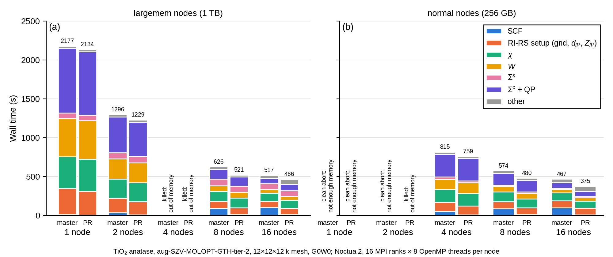

# CP2K PR #6454: test with TiO2 anatase (GW band structure, 12x12x12 k mesh)

Inputs and outputs of a test of [cp2k/cp2k#6454](https://github.com/cp2k/cp2k/pull/6454)
(generic RSKP transform, GEMM and lattice-FFT backends) on a larger periodic system:
TiO2 anatase, 12 atoms in the unit cell, aug-SZV-MOLOPT-GTH-tier-2 basis (208 basis functions),
Monkhorst-Pack 12x12x12 k mesh (1728 k points), PBE SCF followed by a periodic RI-RS GW
band structure (G0W0 and evGW0).

## Crash test of PR #6591, 2026-11-18 (`runs_2026-11-18_pr6591_TZ2/`)

TiO2 anatase, aug-TZVP-MOLOPT-GTH-tier-2 (700 basis functions), 12x12x12 k mesh, RS_AO_RATIO 6, G0W0,
SCF restart. Noctua 2, 6 largemem nodes (128 cores, 1 TB RAM per node), 16 MPI ranks x 8 OpenMP threads per node.
`TZ2_pr_largemem_6n`: PR [cp2k/cp2k#6591](https://github.com/cp2k/cp2k/pull/6591) head `4c10ed5186`, crashes at the start of χ
(`double free or corruption (out)` in `prepare_pair_fft`). `TZ2_base_largemem_6n`: master `37e12b533d` (merge base),
passes χ and W, then stops before Σ with the clean abort "Insufficient memory per MPI rank for GW self-energy time groups".
`TZ2_base_largemem_8n`: master `37e12b533d` on 8 largemem nodes, completed (baseline for the fixed PR).
G0W0 indirect gap 3.723 eV. Times in s: SCF 194, RI-RS setup 1483, χ 2163, W 1369, Σx 217, Σc + QP 3437, Total 9078.

## Scaling test 2026-11-15 (`runs_2026-11-15_scaling/`)

G0W0 only (input of `runs_2026-11-14_G0W0/`), Noctua 2, 16 MPI ranks x 8 OpenMP threads per node,
master `db0abe27be` and PR head `fb92e9e185` ("new PR"). Times in seconds from the CP2K timing report:
SCF = `qs_energies` minus `qs_energies_properties`, RI-RS setup = `prepare_ri_rs`, χ = `compute_G_and_chi`,
W = `compute_W0`, Σx = `compute_Sigma_x`, Σc + QP = `compute_Sigma_c_and_QP`, Total = `CP2K`.
The 8-node largemem runs are repeats; the first attempt differed by about ±10 % between nodes.
G0W0 indirect gap: 3.065 eV in every completed run.



#### largemem nodes (128 cores, 1 TB RAM)

| Nodes | Code | SCF | RI-RS setup | χ | W | Σx | Σc + QP | Total |
|---|---|---:|---:|---:|---:|---:|---:|---:|
| 1 | master | 12 | 335 | 410 | 490 | 72 | 832 | **2177** |
| 1 | PR | 4 | 305 | 416 | 495 | 72 | 815 | **2134** |
| 2 | master | 34 | 186 | 249 | 258 | 80 | 461 | **1296** |
| 2 | PR | 6 | 169 | 245 | 256 | 85 | 441 | **1229** |
| 4 | master | killed: out of memory | | | | | | |
| 4 | PR | killed: out of memory | | | | | | |
| 8 | master | 89 | 91 | 131 | 71 | 87 | 124 | **626** |
| 8 | PR | 11 | 86 | 128 | 75 | 76 | 121 | **521** |
| 16 | master | 101 | 81 | 107 | 44 | 77 | 66 | **517** |
| 16 | PR | 10 | 81 | 107 | 44 | 77 | 81 | **466** |

#### normal nodes (128 cores, 256 GB RAM)

| Nodes | Code | SCF | RI-RS setup | χ | W | Σx | Σc + QP | Total |
|---|---|---:|---:|---:|---:|---:|---:|---:|
| 1 | master | clean abort: not enough memory | | | | | | |
| 1 | PR | clean abort: not enough memory | | | | | | |
| 2 | master | clean abort: not enough memory | | | | | | |
| 2 | PR | killed: out of memory | | | | | | |
| 4 | master | 51 | 118 | 165 | 132 | 28 | 294 | **815** |
| 4 | PR | 7 | 113 | 165 | 135 | 26 | 288 | **759** |
| 8 | master | 87 | 91 | 123 | 71 | 18 | 152 | **574** |
| 8 | PR | 10 | 87 | 117 | 70 | 18 | 147 | **480** |
| 16 | master | 97 | 92 | 101 | 44 | 18 | 69 | **467** |
| 16 | PR | 8 | 87 | 90 | 42 | 17 | 68 | **375** |

`extra_checks/`: GW band structures master vs new PR (2D WS2 16x16x1 with SOC, BAs with SOC, CdS, LiF,
Si 12³ and 20³: all gaps identical; Si 9³ aborts in both; Si with `PREFERRED_FFT_LIBRARY FFTSG`: master
runs, new PR aborts).

## G0W0 test 2026-11-14 (`runs_2026-11-14_G0W0/`)

G0W0 only: same input as below without the `&EVGW0` section. Noctua 2, 3 nodes `largemem`
(128 cores and 1 TB RAM per node), 16 MPI ranks x 8 OpenMP threads per node.

| Label | Commit | Description |
|---|---|---|
| master | `db0abe27be` | merge base of PR #6454 with master |
| old PR | `059e7c1d6d` | PR head tested on 2026-11-12 |
| new PR | `30fb7120dc` | PR head on 2026-11-14 (GW always uses the lattice FFT) |

| 3 nodes | master | old PR, GEMM | old PR, FFT | new PR |
|---|---|---|---|---|
| SCF (4 steps from restart) | 71 s | 8 s | 6 s | 4 s |
| χ(iτ), per time point | 53.0–62.2 s | 137.4–155.1 s | 66.6–70.7 s | out of memory at the start of χ |
| Σc(iτ), per time point | 108.4–117.4 s | 211.7–241.3 s | 124.4–131.1 s | – |
| Total | 1041 s | 1511 s | 1042 s | – |
| G0W0 indirect gap | 3.065 eV | 3.065 eV | 3.065 eV | – |

The new PR is killed by the out-of-memory handler right after Z_lP(q), when χ starts
(`cp2k.stderr`), on 3 nodes and also on 6 nodes. The largest memory use per MPI rank is 48 GB with
master; the new PR exceeds the 65 GB available per rank.

## Rerun 2026-11-12 (`runs_2026-11-12/`)

Same inputs, same machine and layout as the first test below (Noctua 2, 16 MPI ranks x 8 OpenMP
threads per node, 4 nodes `normal`, 1 node `hugemem`), with the updated PR:

| Label | Commit | Description |
|---|---|---|
| master | `db0abe27be` | new merge base of PR #6454 with master |
| PR | `059e7c1d6d` | head of PR #6454 on 2026-11-12 |

All runs complete. Total energy (-361.770793768 Ha) and all band gaps are identical in all runs
(indirect gap: PBE 1.971 eV, G0W0 3.065 eV, evGW0 3.425 eV).

| 4 nodes | master | PR, GEMM (default) | PR, FFT |
|---|---|---|---|
| SCF (4 steps from restart) | 45 s | 7 s | 5 s |
| χ(iτ), per time point | 11.8–12.5 s | 27.9–31.5 s | 13.5–14.6 s |
| Σc(iτ), per time point | 17.3–18.6 s | 31.4–35.4 s | 19.2–20.5 s |
| k ↔ R transforms in GW (timer total) | 210 s | 2975 s | 540 s |
| Total | 3421 s | 6151 s | 3735 s |

| 1 node | master | PR, GEMM (default) | PR, FFT |
|---|---|---|---|
| SCF (4 steps from restart) | 17 s | 5 s | 6 s |
| χ(iτ), per time point | 90.1–94.2 s | 231.6–254.0 s | 107.6–114.6 s |
| Σc(iτ), per time point | 277.0–287.3 s | 504.5–569.4 s | 309.7–328.5 s |
| k ↔ R transforms in GW (timer total) | 800 s | 12216 s | 2648 s |
| Total | 12897 s | 24398 s | 14566 s |

k ↔ R timers: master `gw_k_grid_to_real_cells` + `cell_to_k_grid_fft`; PR
`k_to_real_cell_transform` + `cell_to_k_transform`.

## First test, 2026-11-09 (`runs/`)

### Code versions

| Label | Commit | Description |
|---|---|---|
| master | `f37a53adbd` | merge base of PR #6454 with master |
| PR | `611fbac9ee` | head of PR #6454 (`RTChou67:unify-lattice-fft`) |

Both were built identically (Release, GCC 14.3 / gfortran, OpenMPI and OpenBLAS 0.3.30 from
`foss/2025b`, FFTW3 with OpenMP, DBCSR 2.10, libint 2.11, libxc 7.1).

### Hardware and layout

Noctua 2 (Paderborn), 2x AMD EPYC 7763 per node: 128 cores and 256 GB RAM per node (`normal`), 2 TB RAM per node on `hugemem` (used for the 1-node runs).
All runs use 16 MPI ranks x 8 OpenMP threads per node (`OMP_NUM_THREADS=8`), see `run.sbatch`.

### Runs

| Run | Code | `RSKP_TRANSFORM` | Nodes | Result |
|---|---|---|---|---|
| `runs/SZ2_base_4n` | master | (`LATTICE_FFT` default) | 4 | completes, 2849 s total |
| `runs/SZ2_pr_4n` | PR | GEMM (default) | 4 | SIGSEGV in GW (Σx step) after 10.5 min |
| `runs/SZ2_pr_1n` | PR | GEMM (default) | 1 | SIGSEGV at the same place |
| `runs/SZ2_prg_4n` | PR, built with `-g -fbacktrace` | GEMM (default) | 4 | same SIGSEGV, backtrace in `cp2k.stderr` |
| `runs/SZ2_prfft_4n` | PR | FFT | 4 | abort in the first SCF step |

The only input difference between the runs is the line `RSKP_TRANSFORM FFT` in `&KPOINTS` for
`SZ2_prfft_4n`.

#### 1. `RSKP_TRANSFORM FFT`: abort in the SCF

```
R-to-K route is incompatible or forced FFT exceeds the memory budget   (qs_kpoint_operators.F:328)
kpoint_operator_prepare <- do_general_diag_kp <- qs_scf_new_mos_kp <- scf_env_do_scf_inner_loop
```

#### 2. `RSKP_TRANSFORM GEMM` (default): SCF fine, GW slower, then SIGSEGV

The SCF gives the same total energy as master (-361.770793768 Ha). In the GW part:

| Step (4 nodes) | master | PR (GEMM) |
|---|---|---|
| RI-RS grid optimization | 6.2 s | 6.3 s |
| d_lP numerical integration | 75.0 s | 76.1 s |
| Z_lP(q) | 86.7 s | 87.9 s |
| χ(iτ), per time point | 11.9–12.6 s | 27.9–30.9 s |
| W(iω), per frequency point | 2.0–2.2 s | 2.0–2.1 s |
| Σx | completes | SIGSEGV |

The time points of χ are processed in parallel time groups, so the per-point times are the
numbers to compare. On one node, χ(iτ) takes 89–94 s per time point with master and
235–254 s with the PR.

The χ step is about 2.4x slower with the PR. In master, the k → R transform in χ uses the
lattice FFT (`gw_k_grid_to_real_cells`, `cell_to_k_grid_fft`); the PR's GEMM path in
`k_to_real_cell_transform` / `cell_to_k_transform` forms the full phase sum over all
1728 k points and all lattice cells for every matrix element, which scales as N_k^2 per element.

The crash (all 64 ranks, same backtrace, `runs/SZ2_prg_4n/cp2k.stderr`):

```
#0  in ???
#1  in __kpoint_transform_MOD_cell_to_k_transform
#2  in product_to_k_pair_centered
#3  in self_energy_on_mesh
#4  in compute_sigma_x_from_v
#5  in __gw_ri_rs_small_cell_full_kp_utils_MOD_compute_sigma_x
#6  in __gw_ri_rs_small_cell_full_kp_MOD_gw_calc_ri_rs_small_cell_full_kp
#7  in __gw_MOD_run_gw
```

`self_energy_on_mesh` passes chunks of at most 64 MiB of Σ(R) (`chunk(1:n_pairs, :, :)`) to
`product_to_k_pair_centered`, which calls `cell_to_k_transform` with the native 12x12x12 mesh.
The same routine `product_to_k_pair_centered` runs through in the χ step, where it gets the full
array and the q mesh.

### How to rerun

1. Unpack the SCF restart file into the run directory:
   `gunzip -c TiO2_anatase_sz2_2n-RESTART.kp.gz > TiO2_anatase_sz2_2n-RESTART.kp`
   (with `SCF_GUESS ATOMIC` instead of `RESTART` the SCF also works, it just takes longer).
2. `BASIS_AUG_MOLOPT_GTH` and `GTH_POTENTIALS` are the files from `cp2k/data`.
3. Run `cp2k.psmp -i input.inp -o output.out` on 4 nodes with 64 MPI ranks x 8 OpenMP threads.
